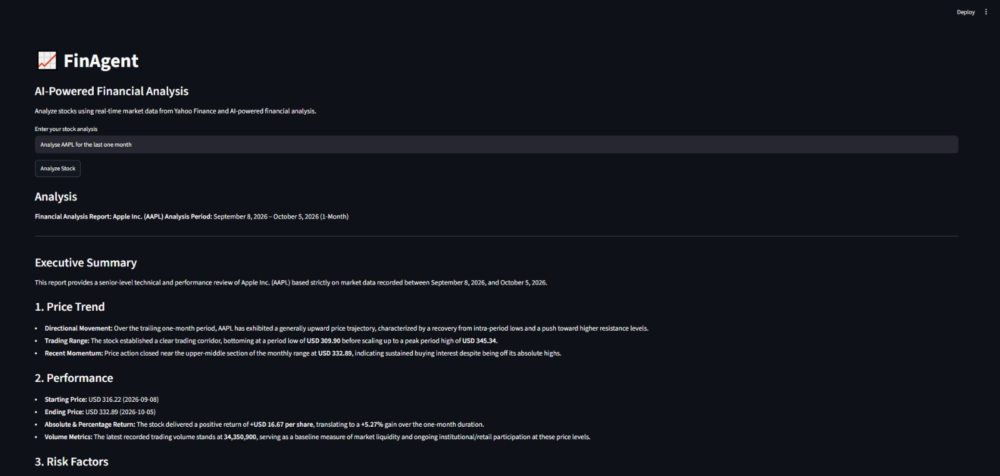

# FinAgent

An AI-powered financial analysis application that combines natural-language queries, Yahoo Finance market data, and Gemini to generate data-grounded stock analysis.

## Demo



## Overview

FinAgent allows users to ask natural-language questions about stocks and receive AI-generated financial analysis based on retrieved market data.

The application retrieves market data from Yahoo Finance and provides the relevant data to a Gemini-powered analyst before generating the response. This helps keep numerical analysis grounded in the retrieved market data rather than relying only on the language model's internal knowledge.

The project uses a simple multi-agent workflow:

1. A Query Parser agent interprets the user's request.
2. Yahoo Finance retrieves the relevant market data.
3. A Market Analyst agent analyzes the retrieved data.
4. Streamlit provides an interactive interface for the user.

## Features

- Natural-language stock analysis queries
- Automatic extraction of stock ticker and analysis period
- Market data retrieval using Yahoo Finance
- AI-powered financial analysis using Gemini
- Price performance and trend analysis
- Period high and low analysis
- Trading volume analysis
- Risk factors and key observations
- Balanced financial perspective
- Interactive Streamlit interface

## Architecture

```text
User Query
    |
    v
Query Parser Agent
    |
    |-- Stock Symbol
    |-- Analysis Type
    |-- Time Period
    |
    v
Yahoo Finance
    |
    v
Market Data
    |
    v
Market Analyst Agent
    |
    v
Data-Grounded Financial Analysis
    |
    v
Streamlit Interface